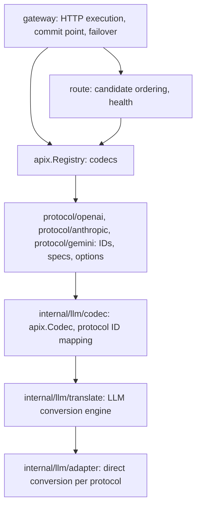

# Code structure and maintenance

English | [简体中文](architecture.zh-CN.md) · [Routing](routing.md) · [Extending](extending.md) · [LLM protocol conversion](protocols/llm.md)

## Layers

- The root package `apix` is protocol neutral. It defines `Kind`, `Protocol`, `Payload`, `ProtocolSpec`, `Codec`, `Exchange`, `StreamConverter`, `Registry`, and the error and diagnostic types. It imports no protocol package.
- Vendor packages are organized by vendor. They hold protocol constants, constructors, and vendor options, and delegate conversion to `internal/llm`.
- `route` decides and never performs I/O. `gateway` is the only package that makes network calls, and it is optional.
- Dependencies are the standard library only; `scripts/check-dependencies.sh` enforces this in CI.

## Registration and dispatch

The registration unit is the codec for one protocol. On the client side, a codec implements `Inspect`, which reads routing information such as model and stream, and `EncodeError`. On the upstream side, it lists the protocols it has a direct path with through `Accepts(p)`: requests convert in from p and responses convert out to p. It creates per-execution state with `NewExchange(client, …)`.

This matches the engine's dispatch: requests dispatch by **target protocol**; ordinary responses and streams dispatch by **upstream protocol**. Both directions of an exchange from client X to upstream Y are therefore implemented by Y's adapter. Responses go back to X by default. A host that chooses the response format separately can set `ExchangeOptions.Output` to another protocol Z of the same Kind; Y's adapter implements that direction too. Conversion paths are always direct, with no intermediate representation. Same-protocol requests only rewrite the model where it belongs in the body. GenerateContent model/stream information travels separately in Payload.Metadata; ProtocolSpec.ParsePath lets the optional HTTP handler recover it from the URL.

`Registry.CanConvert(client, upstream)` requires that both protocols are registered and share a Kind, and that the upstream codec accepts the client protocol. When `Output` is set, `Registry.NewExchange` applies the same check to the output protocol. A registry is immutable after `NewRegistry` and safe for concurrent use. There is no `init()` registration.

## Protocol IDs

Public protocol IDs are namespaced: `openai.chat-completions`, `anthropic.messages`. The LLM engine keeps its historical internal names (`chat-completions`, `responses`, `messages`, `gemini`). The mapping table in `internal/llm/codec` translates in both directions, including diagnostic `From`/`To` values, so adapters and snapshots are unchanged.

The vendor packages, `internal/llm/codec`, and `thinking` declare the same ID constants. Import direction prevents sharing a single declaration, so tests keep them identical.

## Responsibilities

| Location | Responsibility |
| --- | --- |
| `apix.go`, `codec.go`, `registry.go` | Core types, interfaces, and the registry |
| `errors.go`, `diagnostic.go` | Error class aliases, `HTTPStatus`, loss policy, diagnostics |
| `protocol/<vendor>` | Protocol constants, codec constructors, vendor options (`ResponsesOptions`, `MessagesOptions`) |
| `internal/llm/codec` | LLM `apix.Codec`: spec defaults, Inspect, EncodeError, Exchange |
| `internal/llm/translate` | LLM request, response, and stream entry points; terminal error state; SSE framing; Responses sequence numbers; the 48 conversion snapshots |
| `internal/llm/adapter/{chatcompletions,messages,responses}` | Direct conversion per protocol: `request.go`, `convert.go`, `stream.go`, and target stream output |
| `internal/llm/adapter/shared` | Protocol types, content and media, events, tool identities, reasoning, shell, cache hints, diagnostic rules |
| `route` | `Router`, `NativeFirst`, `Breaker`, atomic updates |
| `gateway` | `Gateway.Do`, `Handler`, authentication, stream commit point |
| `sse` | SSE `Framer` and `Decoder`; `shared` keeps aliases |
| `thinking` | Reasoning levels and model suffixes, keyed by public protocol IDs |
| `internal/errclass` | Error classification, status mapping, and redaction |

## Exchanges and state

Use one `Exchange` per execution. Do not reuse it across requests or call it concurrently. An LLM exchange wraps the engine's `RequestState`, which holds a `ConversionContext` with a tool registry, options, and a diagnostic collector. Diagnostics deduplicate in first-observed order and are returned as copies.

Native Responses normalization (`openai.ResponsesOptions{NormalizeTools: true}`) uses `json.RawMessage` to preserve extensions and exact numbers; cross-protocol conversion uses modeled types. Both paths share wire-name generation, declaration deduplication, identity collisions, and history and tool-choice reference checks. Both run under `WithToolTransaction`: success commits the registry, failure keeps the previous identities, and diagnostics survive either way. The loss policy only rejects requests.

## Stream state

Each adapter groups its target output state separately:

- Chat Completions adapter: `messagesOutput`, `responsesOutput`
- Messages adapter: `chatOutput`, `responsesOutput`
- Responses adapter: `messagesOutput`, `nativeOutput`

Source tool identities, argument reconciliation, and termination remain upstream-adapter responsibilities. Chat → Messages and Responses → Messages share `MessagesBlocks`.

`Feed` and `Finish` may return events together with an error, and an error must not discard events that call already produced. A converter keeps its first error and never emits normal events or a successful completion afterwards.

## Gateway commit point

`gateway.Do` returns at the commit point:

- for an ordinary response, after it converts successfully;
- for a stream, after the first converted events arrive.

Before that point, these failures fail over to the next candidate:

- the request did not convert, for example because the loss policy rejected it (nothing was sent);
- the upstream returned an error marked `Retryable`;
- the upstream returned a 2xx response that cannot be decoded or converted; this is reclassified as a retryable `ClassUpstream` error.

After the commit point nothing is retried. Failures surface from `Body.Read` and are reported to health tracking. Cancellation stops immediately and does not count against the endpoint.

## Validation

- Test new protocol behavior through public entry points; use internal tests for parsers and state components.
- `internal/llm/codec` tests require every exchange direction to match the engine byte for byte, so the public API inherits the 48 snapshots. Structural refactors must leave the snapshots unchanged.
- Stream tests cover whole input, bytewise input, a missing final separator, and EOF without a terminal event.
- Gateway tests use `httptest` upstreams to cover native preference, each failover condition, stream failures before and after the commit point, the breaker, and cancellation.

Validation commands are in [CONTRIBUTING.md](../CONTRIBUTING.md).

Gemini direct conversions live in `internal/llm/adapter/gemini`; they read or write Gemini wire objects directly. Native source validation is reused for streams without an intermediate protocol conversion. `internal/llm/adapter/interactions` supports only native validation/passthrough and is dispatched separately from the conversion matrix. See [Gemini](protocols/gemini.md).
