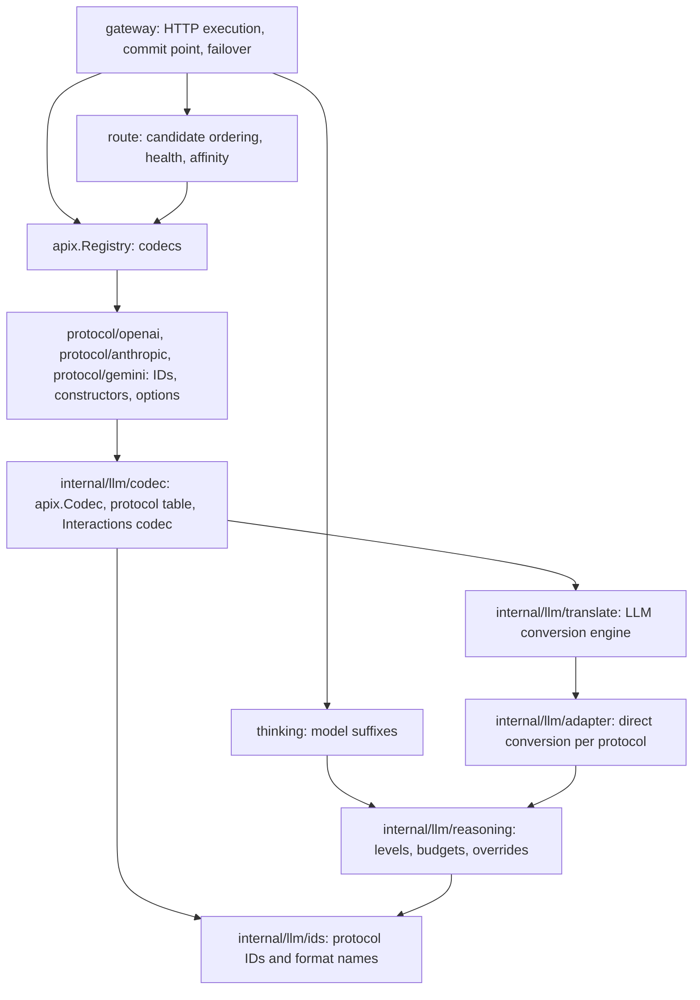

# Code structure and maintenance

English | [简体中文](architecture.zh-CN.md) · [Routing](routing.md) · [Extending](extending.md) · [LLM protocol conversion](protocols/llm.md)

## Layers

- The root package `apix` is protocol neutral. It defines `Kind`, `Protocol`, `Payload`, `ProtocolSpec`, `Codec`, `Exchange`, `StreamConverter`, `Registry`, the optional `OptionsValidator` and `StateReporter` extensions, the `Error` type, and diagnostics. It imports no other package of this module; internal packages refer to its error type through `internal/errclass` aliases.
- Public functions return `error`. Values are `*apix.Error`; read them with `apix.AsError` or `errors.As`. Internal packages keep returning `*apix.Error`, and every public boundary converts a nil pointer to a nil interface explicitly.
- Vendor packages are organized by vendor. They re-export protocol IDs and hold constructors and vendor options, and delegate conversion to `internal/llm`.
- `route` decides and never performs I/O. `gateway` is the only package that makes network calls, and it is optional.
- Dependencies are the standard library only; `scripts/check-dependencies.sh` enforces this in CI.

## Registration and dispatch

The registration unit is the codec for one protocol. On the client side, a codec implements `Inspect`, which reads routing information such as model, stream, required features and state references, and `EncodeError`. On the upstream side, it lists the protocols it has a direct path with through `Accepts(p)`: requests convert in from p and responses convert out to p. It creates per-execution state with `NewExchange(client, …)`. A codec that implements `OptionsValidator` lets `Registry.ValidateOptions` reject options when they are configured.

This matches the engine's dispatch: requests dispatch by **target protocol**; ordinary responses and streams dispatch by **upstream protocol**. Both directions of an exchange from client X to upstream Y are therefore implemented by Y's adapter. Responses go back to X by default. A host that chooses the response format separately can set `ExchangeOptions.Output` to another protocol Z of the same Kind; Y's adapter implements that direction too. Conversion paths are always direct, with no intermediate representation. Same-protocol requests only rewrite the model where it belongs in the body.

GenerateContent is the one exception to the dispatch rule: `internal/llm/adapter/gemini` owns every path with GenerateContent at either end, in both directions, and the engine's entry points route those paths to it first. Gemini wire objects stay the source or destination; nothing converts through another protocol. GenerateContent model/stream information travels separately in `Payload.Metadata`; `ProtocolSpec.ParsePath` lets the optional HTTP handler recover it from the URL.

The four generation protocols share one codec type whose per-protocol differences (path, authentication, headers, error envelope, URL-borne model, extra request checks) are rows of the `protocols` table in `internal/llm/codec/codec.go`. Interactions converts to nothing and has its own codec in `internal/llm/codec/interactions.go`, backed by `internal/llm/adapter/interactions`.

`Registry.CanConvert(client, upstream)` requires that both protocols are registered and share a Kind, and that the upstream codec accepts the client protocol. When `Output` is set, `Registry.NewExchange` applies the same check to the output protocol. `Registry.Inspect` overlays `Payload.Metadata` once, after the codec reads the body. A registry is immutable after `NewRegistry` and safe for concurrent use. There is no `init()` registration.

## Protocol IDs

Public protocol IDs are namespaced: `openai.chat-completions`, `anthropic.messages`. The LLM engine keeps its historical internal names (`chat-completions`, `responses`, `messages`, `gemini`, `interactions`). Both, and the mapping between them, have a single definition in `internal/llm/ids`. The vendor packages re-export the IDs (`const ChatCompletions = ids.ChatCompletions`); the codecs, the engine, and `internal/llm/reasoning` use the same constants, and diagnostic `From`/`To` values are mapped back to public IDs there. Adapters and snapshots are unchanged.

## Responsibilities

| Location | Responsibility |
| --- | --- |
| `apix.go`, `codec.go`, `registry.go` | Core types, interfaces, optional extensions, and the registry |
| `errors.go`, `diagnostic.go` | `Error`, classes and constructors, redaction, `HTTPStatus`, loss policy, diagnostics |
| `protocol/<vendor>` | Re-exported protocol IDs, codec constructors, vendor options (`ResponsesOptions`, `MessagesOptions`, `GenerateContentOptions`) |
| `internal/llm/ids` | Public protocol IDs, internal format names, and the mapping between them |
| `internal/llm/codec` | `codec.go`: the protocol table, the generation codec and its exchange; `inspect.go`, `scan.go`: routing fields, features, affinity keys; `state.go`: created-state capture and the stream error boundary; `envelope.go`: error envelopes; `interactions.go`: the Interactions codec |
| `internal/llm/translate` | LLM request, response, and stream entry points; reasoning overrides; terminal error state; SSE framing; Responses sequence numbers; the 48 conversion snapshots |
| `internal/llm/adapter/{chatcompletions,messages,responses}` | Direct conversion per protocol: `request.go`, `convert.go`, `stream.go`, and target stream output |
| `internal/llm/adapter/gemini` | Every GenerateContent path in both directions: requests, configuration, media, citations, responses, streams |
| `internal/llm/adapter/interactions` | Native Interactions response and stream validation |
| `internal/llm/adapter/shared` | Protocol types, content and media, events, tool identities, reasoning, shell, cache hints, diagnostic rules |
| `internal/llm/reasoning` | Level/budget tables, Gemini level limits, override rendering per protocol, superseded-control stripping |
| `internal/errclass` | Short aliases of `apix.Error` and its constructors for internal packages |
| `route` | `Router`, `NativeFirst`, `Breaker` with half-open trials, `Affinity`, atomic updates |
| `gateway` | `Gateway.Do`, `Handler`, authentication, commit point and timeout, Retry-After, header forwarding, state recording |
| `sse` | SSE `Framer` and `Decoder`; `shared` keeps aliases |
| `thinking` | `model(value)` suffix parsing and public helpers over `internal/llm/reasoning` |

## Exchanges and state

Use one `Exchange` per execution. Do not reuse it across requests or call it concurrently. An LLM exchange wraps the engine's `RequestState`, which holds a `ConversionContext` with a tool registry, options, and a diagnostic collector. Diagnostics deduplicate in first-observed order and are returned as copies.

Native Responses normalization (`openai.ResponsesOptions{NormalizeTools: true}`) uses `json.RawMessage` to preserve extensions and exact numbers; cross-protocol conversion uses modeled types. Both paths share wire-name generation, declaration deduplication, identity collisions, and history and tool-choice reference checks. Both run under `WithToolTransaction`: success commits the registry, failure keeps the previous identities, and diagnostics survive either way. The loss policy only rejects requests; `ConversionContext.ValidatePolicy` is the one check of its value.

`ExchangeOptions.Reasoning` runs in three steps inside `ConvertRequest`: the client's own control is stripped where conversion derives the target control from it, the request converts, and the override is rendered on the converted body with the exchange's Messages and Gemini thinking modes. A value the target cannot express exactly, such as `max` for a Gemini level, is approximated and reported as a request loss.

Exchanges whose upstream stores state implement `apix.StateReporter`. A native Responses exchange captures the response ID from the converted body or from `response.created`; an Interactions exchange captures the interaction ID. Cross-protocol Responses output reports nothing, because its ID refers to nothing an upstream stored.

## Stream state

Each adapter groups its target output state separately:

- Chat Completions adapter: `messagesOutput`, `responsesOutput`
- Messages adapter: `chatOutput`, `responsesOutput`
- Responses adapter: `messagesOutput`, `nativeOutput`
- Gemini adapter: one `StreamConverter` per direction; with GenerateContent as the target, the source protocol's native converter validates complete frames first (`validatedGeminiStream`)

Source tool identities, argument reconciliation, and termination remain upstream-adapter responsibilities. Chat → Messages and Responses → Messages share `MessagesBlocks`.

`Feed` and `Finish` may return events together with an error, and an error must not discard events that call already produced. A converter keeps its first error and never emits normal events or a successful completion afterwards.

## Gateway commit point

`gateway.Do` returns at the commit point:

- for an ordinary response, after it converts successfully;
- for a stream, after the first converted events arrive.

Before that point, these failures fail over to the next candidate:

- the request did not convert, for example because the loss policy rejected it (nothing was sent);
- the endpoint is half-open and `Router.Begin` refused a second trial (nothing was sent);
- the upstream returned an error marked `Retryable`, including 404, or the attempt exceeded `CommitTimeout`;
- the upstream returned a 2xx response that cannot be decoded or converted, or exceeds `MaxResponseBytes`; this is reclassified as a retryable `ClassUpstream` error.

After the commit point nothing is retried. Failures surface from `Body.Read` and are reported to health tracking. Cancellation stops immediately and does not count against the endpoint. The upstream path comes from the converted payload's metadata, and created state is passed to `Router.Remember` at the commit point and again at the end of a stream.

## Validation

- Test new protocol behavior through public entry points; use internal tests for parsers and state components.
- `internal/llm/codec` tests require every exchange direction to match the engine byte for byte, so the public API inherits the 48 snapshots. Structural refactors must leave the snapshots unchanged.
- Stream tests cover whole input, bytewise input, a missing final separator, and EOF without a terminal event.
- Gateway tests use `httptest` upstreams to cover native preference, each failover condition, stream failures before and after the commit point, the breaker, commit timeouts, affinity, and cancellation.

Validation commands are in [CONTRIBUTING.md](../CONTRIBUTING.md). See [Gemini](protocols/gemini.md) for GenerateContent and Interactions specifics.
