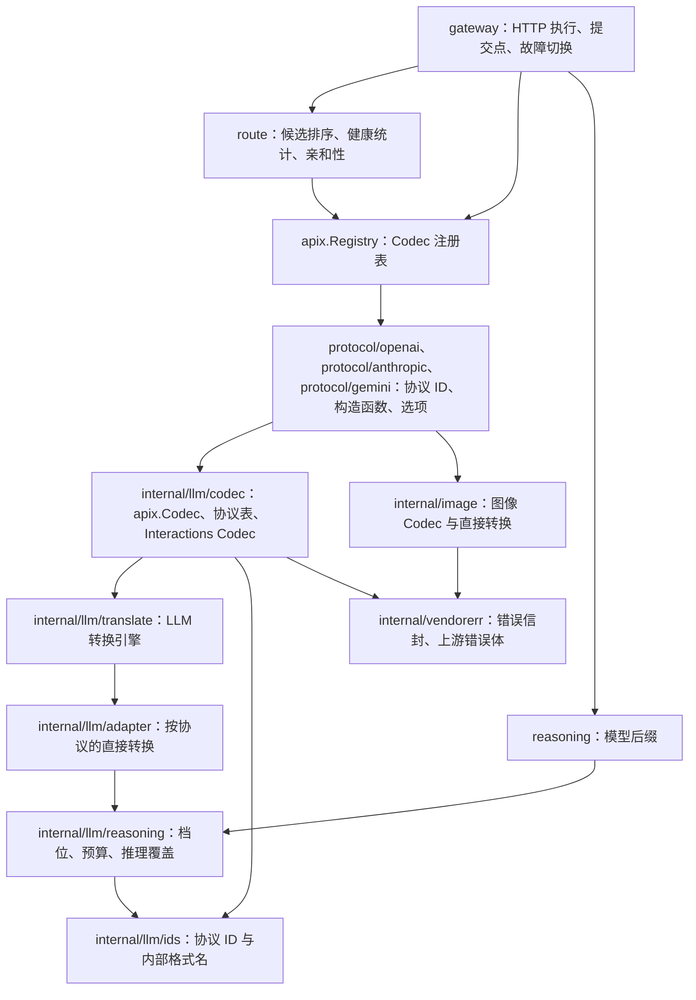

# 代码结构与维护约定

[English](architecture.md) | 简体中文 · [路由](routing.zh-CN.md) · [扩展](extending.zh-CN.md) · [LLM 协议转换](protocols/llm.zh-CN.md)

## 分层

- 根包 `apix` 与协议无关，定义 `Kind`、`Protocol`、`Payload`、`ProtocolSpec`、`Codec`、`Exchange`、`StreamConverter`、`Registry`、可选扩展 `OptionsValidator` 与 `StateReporter`、`Error` 类型和诊断类型。根包不 import 本模块的任何其他包；内部包通过 `internal/errclass` 的别名使用它的错误类型。
- 公开函数返回 `error`，其值为 `*apix.Error`，用 `apix.AsError` 或 `errors.As` 读取。内部包仍返回 `*apix.Error`，每个公开边界都显式地把 nil 指针转换为 nil 接口。
- 供应商包按厂商组织，重新导出协议 ID，放构造函数和厂商专属选项，实际转换委托给 `internal/llm`（LLM）或 `internal/image`（图像生成与编辑）。
- `route` 只做决策，不做 I/O；`gateway` 是唯一执行网络请求的包，可以不用。
- 依赖仅限标准库，CI 用 `scripts/check-dependencies.sh` 检查。

## 注册与分派

注册单元是「一个协议的 Codec」。Codec 在客户端一侧负责 `Inspect`（读取 model、stream、所需能力和状态引用）和 `EncodeError`；在上游一侧通过 `Accepts(p)` 声明与哪些协议之间存在直接路径（请求可以从 p 转入，响应可以转出为 p），并用 `NewExchange(client, …)` 创建单次执行的状态。实现了 `OptionsValidator` 的 Codec 让 `Registry.ValidateOptions` 在配置阶段就能拒绝错误选项。

这与引擎原有的分派方式一致：请求按**目标协议**分派，普通响应和流式响应按**上游协议**分派。因此「客户端 X → 上游 Y」一次交换的两个方向都由 Y 的适配器实现。响应默认转回 X；宿主若单独指定了响应格式，可以通过 `ExchangeOptions.Output` 转为同 Kind 的另一协议 Z，这一方向同样由 Y 的适配器实现。转换始终是直接路径，不经过中间表示。同协议请求只改写模型。

GenerateContent 是分派规则的唯一例外：`internal/llm/adapter/gemini` 负责任一端为 GenerateContent 的全部路径（双向），引擎入口会先把这些路径交给它。Gemini wire 对象始终是源或目标，不经其他协议中转。GenerateContent 的模型和流式模式通过 `Payload.Metadata` 单独传递；可选的 HTTP Handler 通过 `ProtocolSpec.ParsePath` 从 URL 中取回。

四种生成协议共用一个 Codec 类型，各协议在 Codec 边界上的差异（路径、鉴权、固定头、错误信封、URL 中的模型、额外的请求校验）是 `internal/llm/codec/codec.go` 中 `protocols` 表的一行。Interactions 不与任何协议转换，单独实现于 `internal/llm/codec/interactions.go`，底层是 `internal/llm/adapter/interactions`。

`Registry.CanConvert(client, upstream)` 要求两端都已注册、属于同一 Kind，并且上游 Codec 接受该客户端协议。设置了 `Output` 时，`Registry.NewExchange` 还会对输出协议做同样的检查。`Registry.Inspect` 在 Codec 读取请求体之后叠加一次 `Payload.Metadata`。Registry 在 `NewRegistry` 之后不可变，可以并发使用。不提供 `init()` 全局注册。

## 协议 ID

公开协议 ID 带命名空间，例如 `openai.chat-completions`、`anthropic.messages`。LLM 引擎内部仍使用旧格式名（`chat-completions`、`responses`、`messages`、`gemini`、`interactions`）。两者及其映射只在 `internal/llm/ids` 中定义一次。供应商包重新导出这些 ID（`const ChatCompletions = ids.ChatCompletions`），Codec、引擎和 `internal/llm/reasoning` 使用同一组常量，诊断的 `From/To` 也在这里映射回公开 ID。

## 文件职责

| 位置 | 职责 |
| --- | --- |
| `apix.go`、`codec.go`、`registry.go` | 核心类型、接口、可选扩展与注册表 |
| `errors.go`、`diagnostic.go` | `Error`、错误分类与构造函数、脱敏、`HTTPStatus`、损耗策略与诊断 |
| `protocol/<vendor>` | 重新导出的协议 ID、Codec 构造函数、厂商选项（`ResponsesOptions`、`MessagesOptions`、`GenerateContentOptions`）；图像协议在 `images.go` |
| `internal/llm/ids` | 公开协议 ID、内部格式名及两者的映射 |
| `internal/llm/codec` | `codec.go`：协议表、生成协议 Codec 及其 Exchange；`inspect.go`、`scan.go`：路由字段、能力、亲和键；`state.go`：新建状态的捕获与流式错误边界；`interactions.go`：Interactions Codec |
| `internal/llm/translate` | LLM 请求、响应、流式入口，推理覆盖，错误状态锁定，SSE 包装，Responses 序号；48 份转换快照 |
| `internal/llm/adapter/{chatcompletions,messages,responses}` | 按协议组织的直接转换：`request.go`、`convert.go`、`stream.go` 以及各目标的流式输出 |
| `internal/llm/adapter/gemini` | GenerateContent 的全部双向路径：请求、配置、媒体、引用、响应、流 |
| `internal/llm/adapter/interactions` | 原生 Interactions 响应与流的校验 |
| `internal/llm/adapter/shared` | 协议类型、内容与媒体、事件构造、工具身份、推理、shell、缓存提示、诊断规则 |
| `internal/llm/reasoning` | 档位/预算表、Gemini 档位上限、按协议渲染推理覆盖、剥离被取代的推理控制 |
| `internal/image` | `KindImage` 的 Codec：OpenAI generations 与 edits、图像模型的 GenerateContent、Imagen；直接的请求与响应转换、原生流校验、模拟流 |
| `internal/vendorerr` | 各厂商错误信封与上游错误体分类，所有 Kind 共用 |
| `internal/errclass` | 供内部包使用的 `apix.Error` 及构造函数短别名 |
| `route` | `Router`、`NativeFirst`、带半开试探的 `Breaker`、`Affinity`、热更新 |
| `gateway` | `Gateway.Do`、`Handler`、鉴权注入、提交点与超时、Retry-After、响应头透传、状态记录 |
| `sse` | SSE 分帧（`Framer`）与解码（`Decoder`）；shared 中保留别名 |
| `reasoning` | `model(value)` 后缀解析，以及基于 `internal/llm/reasoning` 的公开辅助函数 |

## Exchange 与状态

每次执行使用一个 `Exchange`，不跨请求复用，也不并发调用。LLM 的 Exchange 包装引擎的 `RequestState`，其中包含 `ConversionContext`：工具注册表、转换选项和诊断收集器。诊断按首次记录顺序去重，返回独立副本。

原生 Responses 规范化（`openai.ResponsesOptions{NormalizeTools: true}`）使用 `json.RawMessage` 保留未知字段和精确数值；跨协议路径使用已建模类型。两条路径共享工具名称展开、声明去重、身份碰撞，以及历史和 tool choice 引用的校验。它们都通过 `WithToolTransaction` 执行：成功时提交注册表，失败时保留原身份，两种结果都保留诊断。损耗策略只影响请求，其取值只由 `ConversionContext.ValidatePolicy` 一处检查。

`ExchangeOptions.Reasoning` 在 `ConvertRequest` 中分三步执行：先在转换会据此推导目标推理控制的路径上剥离客户端自己的控制，再转换请求，最后按 Exchange 的 Messages、Gemini 推理模式在转换结果上渲染覆盖值。目标无法精确表达的值（如 Gemini 档位中的 `max`）会被近似，并作为请求损耗报告。

上游会存储状态的 Exchange 实现 `apix.StateReporter`。原生 Responses Exchange 从转换后的响应体或 `response.created` 中捕获 response ID，Interactions Exchange 捕获 interaction ID。跨协议输出的 Responses 不报告任何状态，因为它的 ID 并不对应上游存储的对象。

## 流式状态

适配器分别组织各目标的输出状态：

- Chat Completions 适配器：`messagesOutput`、`responsesOutput`；
- Messages 适配器：`chatOutput`、`responsesOutput`；
- Responses 适配器：`messagesOutput`、`nativeOutput`；
- Gemini 适配器：每个方向一个 `StreamConverter`；以 GenerateContent 为目标时，先由源协议的原生转换器校验完整帧（`validatedGeminiStream`）。

源工具身份、参数补齐和协议结束判断由上游适配器负责。Chat → Messages 与 Responses → Messages 共用 `MessagesBlocks`。

`Feed` / `Finish` 可以同时返回事件和错误，错误不能丢弃本次调用已经生成的事件。转换器锁定首个错误，之后不再产生正常事件，也不会报告成功结束。

## 网关提交点

`gateway.Do` 只在提交点返回：

- 普通响应：转换成功之后；
- 流式响应：拿到第一批转换后的事件之后。

提交点之前，以下失败会切换到下一个候选：

- 请求转换失败，例如被损耗策略拒绝（请求尚未发出）；
- 端点处于半开状态，`Router.Begin` 拒绝了第二个试探请求（请求尚未发出）；
- `Retryable` 的上游错误（包括 404），或单次尝试超过 `CommitTimeout`；
- 上游返回了 2xx，但内容无法解码或转换，或超过 `MaxResponseBytes`。这类失败会被重新归类为可重试的 `ClassUpstream`。

提交点之后的失败不重试，通过 `Body.Read` 返回，并回报给健康统计。请求被取消时立即停止，也不计入端点失败。上游路径由转换后 Payload 的元信息生成；新建的状态在提交点和流结束时交给 `Router.Remember`。

## 验证约定

- 新的协议行为优先通过公开入口测试，内部测试只覆盖解析器和状态组件。
- `internal/llm/codec` 的测试保证每个 Exchange 方向的输出与引擎逐字节一致，因此公开 API 继承 48 份快照的约束。结构重构不应更新快照。
- 流式测试覆盖以下输入：完整输入、逐字节输入、缺少最终分隔符、EOF 前没有终止事件。
- gateway 用 `httptest` 模拟上游，覆盖同协议优先、各类切换条件、提交点前后的流式失败、熔断、提交超时、亲和性和取消。

验证命令见 [CONTRIBUTING.md](../CONTRIBUTING.md)。GenerateContent 与 Interactions 的细节见 [Gemini](protocols/gemini.zh-CN.md)，`KindImage` 见[图像协议转换](protocols/image.zh-CN.md)。
