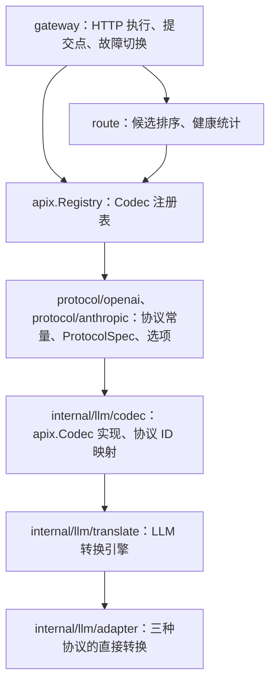

# 代码结构与维护约定

[English](architecture.md) | 简体中文 · [路由](routing.zh-CN.md) · [扩展](extending.zh-CN.md) · [LLM 协议转换](protocols/llm.zh-CN.md)

## 分层

- 根包 `apix` 与协议无关，只定义 `Kind`、`Protocol`、`Payload`、`ProtocolSpec`、`Codec`、`Exchange`、`StreamConverter`、`Registry`、错误和诊断类型。根包不 import 任何协议包。
- 供应商包按厂商组织，只放协议常量、构造函数和厂商专属选项，实际转换委托给 `internal/llm`。
- `route` 只做决策，不做 I/O；`gateway` 是唯一执行网络请求的包，可以不用。
- 依赖仅限标准库，CI 用 `scripts/check-dependencies.sh` 检查。

## 注册与分派

注册单元是「一个协议的 Codec」。Codec 在客户端一侧负责 `Inspect`（读取 model、stream 等路由信息）和 `EncodeError`；在上游一侧通过 `Accepts(p)` 声明与哪些协议之间存在直接路径（请求可以从 p 转入，响应可以转出为 p），并用 `NewExchange(client, …)` 创建单次执行的状态。

这与引擎原有的分派方式一致：请求按**目标协议**分派，普通响应和流式响应按**上游协议**分派。因此「客户端 X → 上游 Y」一次交换的两个方向都由 Y 的适配器实现。响应默认转回 X；宿主若单独指定了响应格式，可以通过 `ExchangeOptions.Output` 转为同 Kind 的另一协议 Z，这一方向同样由 Y 的适配器实现。转换始终是直接路径，不经过中间表示。同协议请求只改写模型。

`Registry.CanConvert(client, upstream)` 要求两端都已注册、属于同一 Kind，并且上游 Codec 接受该客户端协议。设置了 `Output` 时，`Registry.NewExchange` 还会对输出协议做同样的检查。Registry 在 `NewRegistry` 之后不可变，可以并发使用。不提供 `init()` 全局注册。

## 协议 ID

公开协议 ID 带命名空间，例如 `openai.chat-completions`、`anthropic.messages`。LLM 引擎内部仍使用旧格式名（`chat-completions`、`responses`、`messages`），由 `internal/llm/codec` 的映射表负责双向转换，诊断的 `From/To` 也在这里映射回公开 ID。这样适配器和快照不需要改动。

供应商包与 `internal/llm/codec`、`thinking` 各自声明同样的 ID 常量。声明重复是因为存在 import 方向限制，由测试保证三者一致。

## 文件职责

| 位置 | 职责 |
| --- | --- |
| `apix.go`、`codec.go`、`registry.go` | 核心类型、接口与注册表 |
| `errors.go`、`diagnostic.go` | 错误分类别名、`HTTPStatus`、损耗策略与诊断 |
| `protocol/<vendor>` | 协议常量、Codec 构造函数、厂商选项（`ResponsesOptions`、`MessagesOptions`） |
| `internal/llm/codec` | LLM 的 `apix.Codec` 实现：Spec 默认值、Inspect、EncodeError、Exchange |
| `internal/llm/translate` | LLM 请求、响应、流式入口，错误状态锁定，SSE 包装，Responses 序号；27 份转换快照 |
| `internal/llm/adapter/{chatcompletions,messages,responses}` | 按协议组织的直接转换：`request.go`、`convert.go`、`stream.go` 以及各目标的流式输出 |
| `internal/llm/adapter/shared` | 协议类型、内容与媒体、事件构造、工具身份、推理、shell、缓存提示、诊断规则 |
| `route` | `Router`、`NativeFirst`、`Breaker`、热更新 |
| `gateway` | `Gateway.Do`、`Handler`、鉴权注入、流式提交点 |
| `sse` | SSE 分帧（`Framer`）与解码（`Decoder`）；shared 中保留别名 |
| `thinking` | 推理档位与模型后缀，参数为公开协议 ID |
| `internal/errclass` | 错误分类、状态映射与脱敏 |

## Exchange 与状态

每次执行使用一个 `Exchange`，不跨请求复用，也不并发调用。LLM 的 Exchange 包装引擎的 `RequestState`，其中包含 `ConversionContext`：工具注册表、转换选项和诊断收集器。诊断按首次记录顺序去重，返回独立副本。

原生 Responses 规范化（`openai.ResponsesOptions{NormalizeTools: true}`）使用 `json.RawMessage` 保留未知字段和精确数值；跨协议路径使用已建模类型。两条路径共享工具名称展开、声明去重、身份碰撞，以及历史和 tool choice 引用的校验。它们都通过 `WithToolTransaction` 执行：成功时提交注册表，失败时保留原身份，两种结果都保留诊断。损耗策略只影响请求。

## 流式状态

适配器分别组织各目标的输出状态：

- Chat Completions 适配器：`messagesOutput`、`responsesOutput`；
- Messages 适配器：`chatOutput`、`responsesOutput`；
- Responses 适配器：`messagesOutput`、`nativeOutput`。

源工具身份、参数补齐和协议结束判断由上游适配器负责。Chat → Messages 与 Responses → Messages 共用 `MessagesBlocks`。

`Feed` / `Finish` 可以同时返回事件和错误，错误不能丢弃本次调用已经生成的事件。转换器锁定首个错误，之后不再产生正常事件，也不会报告成功结束。

## 网关提交点

`gateway.Do` 只在提交点返回：

- 普通响应：转换成功之后；
- 流式响应：拿到第一批转换后的事件之后。

提交点之前，以下失败会切换到下一个候选：

- 请求转换失败，例如被损耗策略拒绝（请求尚未发出）；
- `Retryable` 的上游错误；
- 上游返回了 2xx，但内容无法解码或转换。这类失败会被重新归类为可重试的 `ClassUpstream`。

提交点之后的失败不重试，通过 `Body.Read` 返回，并回报给健康统计。请求被取消时立即停止，也不计入端点失败。

## 验证约定

- 新的协议行为优先通过公开入口测试，内部测试只覆盖解析器和状态组件。
- `internal/llm/codec` 的测试保证每个 Exchange 方向的输出与引擎逐字节一致，因此公开 API 继承 27 份快照的约束。结构重构不应更新快照。
- 流式测试覆盖以下输入：完整输入、逐字节输入、缺少最终分隔符、EOF 前没有终止事件。
- gateway 用 `httptest` 模拟上游，覆盖同协议优先、各类切换条件、提交点前后的流式失败、熔断和取消。

验证命令见 [CONTRIBUTING.md](../CONTRIBUTING.md)。
