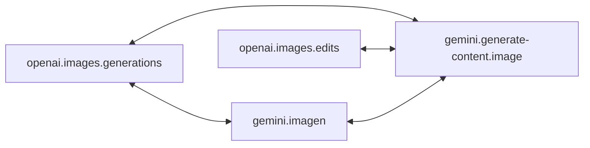

# Image protocol conversion

English | [简体中文](image.zh-CN.md) · [Back to README](../../README.md)

Image generation and editing protocols belong to `apix.KindImage`. They convert only among themselves; an image request never reaches an LLM endpoint, and the reverse holds too. The implementation lives in `internal/image`; `protocol/openai` and `protocol/gemini` export the IDs and constructors, and `openai.Codecs()` and `gemini.Codecs()` include them.

| Protocol ID | Constant | Endpoint | Streams |
| --- | --- | --- | --- |
| `openai.images.generations` | `openai.ImagesGenerations` | `POST /v1/images/generations` (JSON) | SSE |
| `openai.images.edits` | `openai.ImagesEdits` | `POST /v1/images/edits` (multipart, or JSON with data URLs and file IDs) | SSE |
| `gemini.generate-content.image` | `gemini.GenerateContentImage` | `POST /v1beta/models/{model}:generateContent` / `:streamGenerateContent` to an image model | SSE |
| `gemini.imagen` | `gemini.Imagen` | `POST /v1beta/models/{model}:predict` | no |

`gemini.generate-content.image` uses the GenerateContent wire format with image models such as `gemini-2.5-flash-image`. It has its own ID because it belongs to another Kind than `gemini.generate-content`; mount the handler of whichever Kind a URL serves. Like GenerateContent, the model and streaming mode live in the URL and travel in `Payload.Metadata`; `ProtocolSpec.ParsePath` recovers them for `gateway.Handler`.

## Direct paths



There is no path between generations and edits: a generation has no input image, and an edit needs one. A GenerateContent request converts to generations when it has no input image and to edits when it has one; the other conversion fails before anything is sent, and the gateway moves to the next candidate. Imagen takes no input images.

## Requests

| OpenAI | GenerateContent | Imagen |
| --- | --- | --- |
| `prompt` | text parts of the user turns, joined by blank lines | `instances[0].prompt` |
| `image` / `image[]` / `images[].image_url` (data URL) | `inlineData` parts after the text | — |
| `n` | `generationConfig.candidateCount` | `parameters.sampleCount` |
| `size` | `imageConfig.aspectRatio` and `imageSize` | `parameters.aspectRatio` and `imageSize` |
| `output_format`, `output_compression` | — | `parameters.outputOptions.mimeType`, `compressionQuality` (to OpenAI only) |
| — | `responseModalities: ["IMAGE"]` on converted requests; see [options](#options) | — |

Size mapping:

- OpenAI to Google: the nearest supported aspect ratio on a log scale; the image size is the nearest of 1K, 2K and 4K by pixel count, and 1K (the default) is left out. Imagen stops at 2K. `auto` maps to nothing.
- Google to OpenAI: the sizes every GPT image model accepts, `1024x1024`, `1536x1024` (landscape) or `1024x1536` (portrait). Google image sizes are not carried.
- An aspect ratio that changes is reported as a non-semantic loss.

Edits to OpenAI are sent as multipart forms: one image as `image`, several as `image[]`. Native requests keep their own form or JSON body and only rewrite `model` (and `stream` when needed).

Losses are reported as diagnostics and checked against the loss policy:

| Source field | Semantic |
| --- | --- |
| OpenAI `mask`, `background: "transparent"`, `response_format: "url"`, unknown fields | yes |
| OpenAI `quality` (other than `auto`), `output_format` (other than `png`), `output_compression`, `partial_images`, `moderation`, `style`, `user`, `safety_identifier`, `input_fidelity` | no |
| GenerateContent model turns, `systemInstruction`, `tools`, `cachedContent`, non-text parts, unknown fields | yes |
| GenerateContent other `generationConfig` fields, `safetySettings`, a text modality | no |
| Imagen further instances, instance fields other than `prompt`, `negativePrompt`, unknown fields | yes |
| Imagen `personGeneration`, `seed` and other parameters | no |

Conversion performs no I/O, so input it would have to fetch fails with `ClassUnsupported`: OpenAI file IDs, remote image URLs, and GenerateContent `fileData`. Those references set affinity keys (`file:<id>`), so native endpoints that own them come first.

## Options

`gemini.GenerateContentImageOptions` configures a GenerateContentImage upstream, usually per endpoint through `route.EndpointOptions.Ext`:

```go
route.Endpoint{
    ID: "nano", Protocol: gemini.GenerateContentImage,
    Options: route.EndpointOptions{Ext: gemini.GenerateContentImageOptions{
        ResponseModalities: []gemini.Modality{gemini.ModalityText, gemini.ModalityImage},
    }},
}
```

`ResponseModalities` applies to every request the endpoint receives: it replaces `["IMAGE"]` on converted requests and the client's `responseModalities` (camelCase or snake_case) on native GenerateContentImage requests, keeping their other fields. It must include `ModalityImage` and list each modality once. Empty keeps the defaults: `["IMAGE"]` on converted requests, the client's body unchanged on native ones. Invalid values fail when the endpoint is configured. The override is endpoint configuration, not a conversion loss, so it records no diagnostic. Text the model returns is dropped and reported as a response loss when the output is OpenAI or Imagen. The other image protocols define no options.

## Responses

- Images become `b64_json` entries, `inlineData` parts, or `bytesBase64Encoded` predictions. Thought images from GenerateContent are skipped; its visible text and OpenAI `revised_prompt` are reported as response losses.
- When a GenerateContent client asked for several candidates, each image becomes its own candidate; otherwise all images share one.
- Usage converts between OpenAI `usage` and `usageMetadata`, including the text and image token details. Thought tokens count as output. Imagen has no usage field.
- An OpenAI result that only has a `url` cannot be converted without fetching it and fails as an unusable upstream response, so the gateway fails over.
- A response without images is an error. Safety, prohibited-content, recitation and blocked-prompt stops, and Imagen's filtered predictions, return `ClassUnsupported` and are not retried. Other stops, such as `NO_IMAGE`, are retryable.

## Streams

- **Native**: a stream passes through, validated, when the upstream speaks the output protocol. An OpenAI stream ends once it carries as many `*.completed` events as images requested; EOF after at least one is accepted. A GenerateContent stream must carry a finish reason or a blocked prompt. Error events fail the stream.
- **Emulated**: otherwise the upstream is called without streaming, and the converted response is returned as the output protocol's complete event stream with `Content-Type: text/event-stream`: one `image_generation.completed` or `image_edit.completed` event per image (usage on the last), or one GenerateContent chunk. Partial images are not produced and `partial_images` is reported. `gateway.Response.Stream` is false for these responses because the body arrives at once. Imagen output never streams.

`FuzzImageStreamChunkBoundaries`, `FuzzImageRequest` and `FuzzImageResponse` in `internal/image` check these rules on hostile input: stream results do not depend on chunk boundaries and only end on a terminal event, failures are terminal, and every converted request or response is accepted by its target protocol's own codec. `make fuzz` runs them.

The streaming mode always travels in the converted payload's `Metadata.Stream`, so executors know whether the upstream will stream even when the client asked to.
