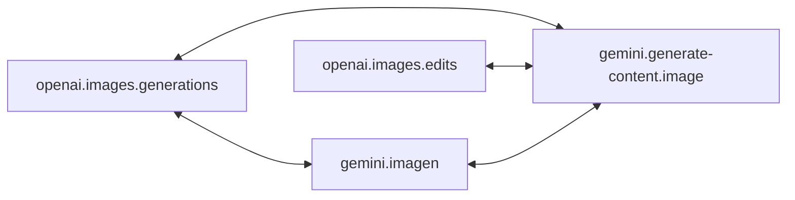

# 图像协议转换

[English](image.md) | 简体中文 · [返回 README](../../README.zh-CN.md)

图像生成与编辑协议属于 `apix.KindImage`，只在彼此之间转换；图像请求不会被路由到 LLM 端点，反之亦然。实现位于 `internal/image`；`protocol/openai` 与 `protocol/gemini` 导出 ID 和构造函数，`openai.Codecs()`、`gemini.Codecs()` 已包含它们。

| 协议 ID | 常量 | 端点 | 流式 |
| --- | --- | --- | --- |
| `openai.images.generations` | `openai.ImagesGenerations` | `POST /v1/images/generations`（JSON） | SSE |
| `openai.images.edits` | `openai.ImagesEdits` | `POST /v1/images/edits`（multipart，或以 data URL、文件 ID 引用图像的 JSON） | SSE |
| `gemini.generate-content.image` | `gemini.GenerateContentImage` | 发往图像模型的 `POST /v1beta/models/{model}:generateContent` / `:streamGenerateContent` | SSE |
| `gemini.imagen` | `gemini.Imagen` | `POST /v1beta/models/{model}:predict` | 否 |

`gemini.generate-content.image` 使用 GenerateContent 线格式，面向 `gemini-2.5-flash-image` 等图像模型。它与 `gemini.generate-content` 属于不同 Kind，所以有独立 ID；某个 URL 服务哪种 Kind，就挂载哪种 Kind 的 handler。与 GenerateContent 相同，模型和流式模式位于 URL 中，经 `Payload.Metadata` 传递；`gateway.Handler` 通过 `ProtocolSpec.ParsePath` 取回它们。

## 直连路径



generations 与 edits 之间没有路径：生成没有输入图像，编辑必须有。GenerateContent 请求没有输入图像时转换为 generations，有输入图像时转换为 edits；另一种转换会在发送前失败，gateway 随即换下一个候选。Imagen 不接受输入图像。

## 请求

| OpenAI | GenerateContent | Imagen |
| --- | --- | --- |
| `prompt` | 用户轮次的文本部分，以空行连接 | `instances[0].prompt` |
| `image` / `image[]` / `images[].image_url`（data URL） | 文本之后的 `inlineData` 部分 | — |
| `n` | `generationConfig.candidateCount` | `parameters.sampleCount` |
| `size` | `imageConfig.aspectRatio` 与 `imageSize` | `parameters.aspectRatio` 与 `imageSize` |
| `output_format`、`output_compression` | — | `parameters.outputOptions.mimeType`、`compressionQuality`（仅转往 OpenAI） |
| — | 转换后的请求设置 `responseModalities: ["IMAGE"]`，见[选项](#选项) | — |

尺寸映射：

- OpenAI 转 Google：取对数尺度上最接近的受支持宽高比；图像尺寸按像素数取 1K、2K、4K 中最接近者，默认的 1K 不写出。Imagen 最高 2K。`auto` 不映射。
- Google 转 OpenAI：映射到所有 GPT 图像模型都接受的 `1024x1024`、`1536x1024`（横向）或 `1024x1536`（纵向）。Google 的图像尺寸不保留。
- 宽高比发生变化时记为非语义损耗。

转往 OpenAI 的编辑请求以 multipart 表单发送：单图用 `image`，多图用 `image[]`。原生请求保留自身的表单或 JSON，只改写 `model`（必要时改写 `stream`）。

损耗以诊断记录，并按损耗策略检查：

| 源字段 | 语义损耗 |
| --- | --- |
| OpenAI `mask`、`background: "transparent"`、`response_format: "url"`、未知字段 | 是 |
| OpenAI `quality`（非 `auto`）、`output_format`（非 `png`）、`output_compression`、`partial_images`、`moderation`、`style`、`user`、`safety_identifier`、`input_fidelity` | 否 |
| GenerateContent 模型轮次、`systemInstruction`、`tools`、`cachedContent`、非文本部分、未知字段 | 是 |
| GenerateContent 其他 `generationConfig` 字段、`safetySettings`、文本模态 | 否 |
| Imagen 多余实例、`prompt` 以外的实例字段、`negativePrompt`、未知字段 | 是 |
| Imagen `personGeneration`、`seed` 等其他参数 | 否 |

转换不做 I/O，需要拉取的输入会以 `ClassUnsupported` 失败：OpenAI 文件 ID、远程图像 URL、GenerateContent `fileData`。这些引用会设置亲和键（`file:<id>`），持有它们的原生端点优先。

## 选项

`gemini.GenerateContentImageOptions` 配置 GenerateContentImage 上游，通常经 `route.EndpointOptions.Ext` 按端点设置：

```go
route.Endpoint{
    ID: "nano", Protocol: gemini.GenerateContentImage,
    Options: route.EndpointOptions{Ext: gemini.GenerateContentImageOptions{
        ResponseModalities: []gemini.Modality{gemini.ModalityText, gemini.ModalityImage},
    }},
}
```

`ResponseModalities` 作用于该端点收到的所有请求：替换转换后请求中的 `["IMAGE"]`，也替换原生 GenerateContentImage 请求中客户端的 `responseModalities`（camelCase 或 snake_case 均可），其他字段保持不变。它必须包含 `ModalityImage`，且每种模态只能出现一次。为空时保持默认：转换后的请求发送 `["IMAGE"]`，原生请求原样透传。非法值在配置端点时即报错。这项覆盖属于端点配置而不是转换损耗，因此不记录诊断。输出为 OpenAI 或 Imagen 时，模型返回的文本会被丢弃并记为响应损耗。其他图像协议没有选项。

## 响应

- 图像转为 `b64_json` 条目、`inlineData` 部分或 `bytesBase64Encoded` 预测。GenerateContent 的思考图像被跳过；其可见文本与 OpenAI 的 `revised_prompt` 记为响应损耗。
- GenerateContent 客户端请求多个候选时，每张图像各成一个候选；否则所有图像在同一候选中。
- 用量在 OpenAI `usage` 与 `usageMetadata` 之间转换，包括文本与图像 token 明细；思考 token 计入输出。Imagen 没有用量字段。
- 只有 `url` 的 OpenAI 结果无法在不拉取的情况下转换，按不可用的上游响应失败，gateway 会故障转移。
- 没有图像的响应是错误。安全、违禁内容、复述、提示被拦截等停止原因，以及 Imagen 被过滤的预测，返回 `ClassUnsupported`，不重试；`NO_IMAGE` 等其他停止原因可重试。

## 流

- **原生**：上游使用输出协议时，流经校验后透传。OpenAI 流在 `*.completed` 事件数达到请求的图像数时结束；至少有一个时遇到 EOF 也接受。GenerateContent 流必须带有结束原因或提示拦截。错误事件使流失败。
- **模拟**：否则以非流式调用上游，把转换后的响应作为输出协议的完整事件流返回，`Content-Type: text/event-stream`：每张图像一个 `image_generation.completed` 或 `image_edit.completed` 事件（用量在最后一个），或一个 GenerateContent 分块。不产生局部图像，`partial_images` 记为损耗。由于正文一次到达，这类响应的 `gateway.Response.Stream` 为 false。Imagen 输出从不流式。

`internal/image` 中的 `FuzzImageStreamChunkBoundaries`、`FuzzImageRequest`、`FuzzImageResponse` 用恶意输入检验这些规则：流的结果与分块边界无关且只在终止事件后成功结束，失败不可恢复，每个转换后的请求或响应都能被目标协议自己的 codec 接受。`make fuzz` 会运行它们。

流式模式总是由转换后载荷的 `Metadata.Stream` 携带，因此即使客户端要求流式，执行器也知道上游是否会流式返回。
